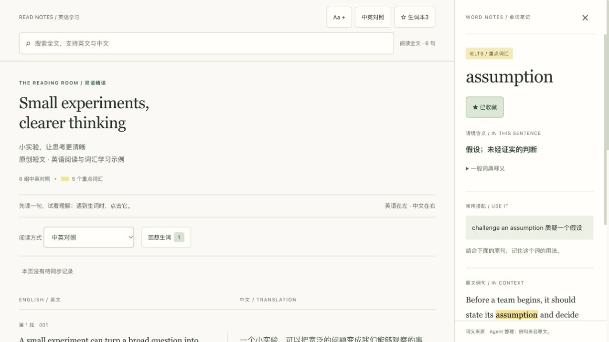

# 互动双语学习阅读器

**把英文文章、文档和视频字幕，交给 AI Agent 整理成可以点击查词的中英对照学习网页。**

用户提供内容，Agent 负责提取、断句、翻译、词汇笔记和网页生成。页面直接展示完整中英对照文稿，提供语境查词与可选的生词复习；下一次把同步记录交给 Agent，旧收藏、例句和复习日期继续保留。

这是一套由 Agent 执行的 Skill，附带固定 HTML 模板和零第三方依赖的 Python 辅助脚本。生成的网页可离线阅读和查词，无需自行搭建后端、配置翻译 API 或部署数据库。获取网页正文、下载字幕和翻译仍需要 Agent 具备相应工具与模型能力。

## 页面是什么样的



*图片使用原创短文演示新版模板。可下载 [示例网页](examples/reader.html) 后用浏览器打开体验；示例生词可随意操作，不含个人数据。*

- **电脑**：完整文章连续展示，英文与中文逐句左右对照，右侧单词笔记。
- **手机**：英文在上、中文在下，点击单词打开底部查词面板。
- **黄色重点词**：默认面向雅思精读，附学习释义和常用搭配。
- **点击查词**：查看语境含义、可靠的一般释义、音标和中英原文例句。
- **阅读工具**：全文搜索、字号调整、中英对照或按句揭示译文。
- **生词复习**：先回想，再看答案和自评；可跳过，也可调整下次复习日期。
- **我的生词本**：收藏、移除、跨文章例句、复习记录、JSON 同步和 CSV 词表。
- **阅读体验**：更清晰的中英排版、键盘操作、明显焦点、窄屏适配和减少动态效果。

模板不包含单词朗读、原句朗读或其他音频功能。

## 能处理哪些内容

| 输入 | Agent 的处理方式 |
| --- | --- |
| 粘贴的英文文章 | 保留正文结构，拆成适合阅读的中英对照单元 |
| 文档文件 | 使用已有文件读取能力，保留标题、列表、引用等结构 |
| 文章或文档链接 | 提取能访问的正文，记录来源 |
| YouTube 单视频链接 | 查询实际字幕轨道，优先人工英文字幕，其次英文自动原字幕 |
| 已下载的字幕 | 处理滚动字幕重叠、断行与标点，保留时间定位 |

默认完整整理内容。用户也可以指定节选、简体或其他中文、日常英语、专业英语等要求。

访问受限、正文不完整、没有英文原字幕或工具无法读取时，Agent 会说明具体情况并接受用户补充文件。自动翻译的英文字幕不会冒充英文原字幕。代码、公式和复杂表格按内容需要保留，必要的模板调整由 Agent 完成。

## 安装

### 交给你的 Agent 安装

把下面这段话发给你的 Agent：

```text
请帮我安装这个 Skill：
https://github.com/lyu054553-sketch/bilingual-learning-reader

读取仓库根目录中的 SKILL.md，并将整个 Skill 文件夹安装到你支持的技能目录。
安装完成后，确认可以使用 bilingual-learning-reader。
```

安装位置和调用方式由你使用的 Agent 平台决定。如果已有同名 Skill，Agent 应先确认现有内容，保留已有修改。

需要 Agent 支持读取 Skill 指令和操作文件。平台不支持直接安装时，也可以让 Agent 读取 `SKILL.md`，按照其中的规范处理内容。

## 怎么使用

### 第一次处理文章

提供文章、文件或链接，然后说：

```text
使用 bilingual-learning-reader Skill，把这篇文章整理成中英对照学习网页。
使用当前工作区的 learning-library 作为我的学习库。
```

默认采用固定页面样式。Agent 建立或读取学习库，整理内容，最后交付 HTML 网页。保存网页后，用浏览器打开阅读。

### 在页面里怎样学习

1. 打开即可阅读全文。需要帮助就看中文；想先尝试英文时，选择“先读英文”，按句揭示译文。
2. 点击生词查看语境含义、搭配和原句，收藏想继续学习的词。黄色只是学习建议，不自动变成收藏。
3. 点击“回想生词”，先尝试回忆词义，需要时看原句提示；揭示后再自评，可以调整复习日期。
4. 导出同步记录交给 Agent，后续文章继续带上收藏和复习安排。

阅读过程不设章节分页、文章理解题或回答框。

### 继续处理下一篇

```text
使用 bilingual-learning-reader Skill，处理这篇新文章，沿用我的学习库。
先合并我提供的生词同步记录，再生成网页。
```

在同一工作区继续使用，Agent 可以读取之前的学习库。换工作区或换设备时，请指定原学习库的位置，或同时提供正式生词本、带底本的同步记录。

### 只同步生词

```text
使用 bilingual-learning-reader Skill，把这份生词同步记录合并到我的学习库，
保留旧笔记和例句，并给我更新后的正式生词本。
```

## 生词如何一直保留

**网页中的收藏缓存和 Agent 的正式生词本是两处数据，需要通过文件同步连接起来。**

完整过程：

1. Agent 读取正式生词本，把已有收藏嵌入新网页。
2. 你阅读、收藏、移除或复习单词，这些记录先保存在本页缓存中。
3. 阅读结束，在“我的生词本”中点击 **导出同步记录**。
4. 将下载的 JSON 交给 Agent，或放进学习库的 `pending/` 目录。
5. Agent 合并后更新正式生词本，下一篇网页继续带上这些收藏。

导出文件通常进入浏览器下载目录，网页不会自动把它写进学习库。缓存不能保存时，页面会提示及时导出。

### 三个按钮分别做什么

| 按钮 | 用途 |
| --- | --- |
| 导出同步记录 | 导出收藏、移除、复习事件、例句和底本，交给 Agent 合并 |
| 导入最新生词本 | 把 Agent 更新后的正式生词本导入旧网页，更新本页快照 |
| 导出词表 | 导出 CSV，方便人工复习；不作为完整同步备份 |

已有网页保存的是生成时的快照。它不会自动收到其他文章的新收藏，可以导入最新正式生词本或让 Agent 重新生成。

### 一个例子

文章 A 中收藏 `thesis` 和 `frontier`，导出并同步。生成文章 B 时，生词本仍有这两个词；B 中如果再次出现 `frontier`，可以补充新的语境例句。再收藏 `retention` 并同步后，共有三个词，旧笔记与原文例句仍然保留。

重复导入相同操作不会重复增加记录。取消收藏也保留变更历史，旧网页快照不能覆盖新版记录或自动恢复已取消的收藏。有版本冲突时，Agent 保留现有数据并列出需要确认的词条。

### 学习库放在哪里

默认使用当前工作区的 `learning-library/`，也可以指定其他目录：

```text
learning-library/
├── library-info.txt          # 学习库位置和使用方法
├── articles.json             # 文章目录
├── vocabulary.json           # 全部文章共用的正式生词本
├── pending/                  # 待合并的同步记录
├── processed/                # 已处理记录
├── articles/
│   └── <article-id>/          # 原文、双语数据和阅读网页
└── backups/                  # 更新正式生词本前的备份
```

用户资料保存在学习库，Skill 文件夹保存通用规范和模板。首次使用才建立学习库，本仓库不包含用户文章或个人生词。

当前版本适合单人顺序使用，采用普通文件存档。多人同时编辑、实时跨设备同步或无需导出的自动同步，需要另行接入存储和应用能力；数据库本身不会自动建立同步通道。

## 学习设计有什么依据

词汇功能借鉴检索练习与间隔学习研究：先回想词义、核对例句，再隔一段时间复习。详情见 [学习依据与证据边界](references/learning-science.md)，列出原始研究及其适用范围。

- 先尝试后核对：词汇提取练习的依据包括 [外语词对实验](https://learninglab.psych.purdue.edu/downloads/2008/2008_Karpicke_Roediger_Science.pdf)。
- 分散复习：间隔应结合目标保留时间，不能套用一个对所有人都最优的公式，见 [Cepeda 等的实验](https://escholarship.org/uc/item/0kp5q19x)。
- 页面只记录行为：收藏、读完或自评都不等于“已掌握”，不设置脑力分数、强制打卡或过期惩罚。

默认复习步长为 1、3、7、14、30 天。没想起来回到 1 天，有些费力维持当前档，较轻松进入下一档；第一次“较轻松”建议 3 天后。用户可选日期覆盖建议。这是启发式安排，不是测量个人遗忘曲线的算法。

这些主要是认知心理学和学习科学的行为证据。**这套阅读器尚未经过学习效果实验，也没有“神经科学认证”。** 实际收益取决于内容质量、学习者是否尝试回忆，以及之后在新语境中的使用；排版美观本身不能证明学习有效。

## 从旧版升级

新版工具接受 v1 生词库与同步包，生成 v2 页面与记录；保留旧词、笔记、例句及移除状态。升级 Skill 后，让 Agent 使用原双语数据和最新学习库重新生成旧网页。先导出旧页面的未同步收藏，不删除旧文件或缓存。旧版 HTML 不能导入 v2 时应重新生成，不能通过删除复习历史降级。

## Agent 怎样执行

```text
确认内容与学习库
  → 读取旧生词并合并同步记录
  → 取得正文或原字幕
  → 整理结构与逐句翻译
  → 生成重点词、词汇笔记和例句
  → 使用固定 HTML 模板生成网页
  → 检查并保存文章记录
  → 交付网页
```

内容规则包括：

- 保留原意、顺序、数字与重要细节，不用摘要冒充全文。
- 每个英文阅读单元对应一条中文译文。
- 不确定的识别结果明确提示，不假装核对过原音。
- 解释与译文分开，一般词义与语境含义分开。
- 优先使用点击位置的原句；额外生成的示例标为“补充例句”。
- 重点词由学习价值决定，不固定数量，也不自动变成用户收藏。
- 长文分批保存进度，支持中断后继续。

## Agent 可直接使用的工具

Python 3 环境中可执行，无需 pip 包：

```sh
python3 scripts/build_reader.py --data bilingual.json --output reader.html --strict-dictionary
python3 scripts/merge_vocabulary.py --library learning-library/vocabulary.json --packet changes.json --output-report merge-report.json
```

生成脚本检查编号、中英完整性和词汇覆盖，再安全写出页面。合并脚本先备份、按编号去重，保留冲突词原值；退出码 `2` 表示非冲突部分已保存但仍需处理冲突。报告不替代翻译审校。没有 Python 时 Agent 可按相同规范处理；不要求用户部署服务。

## 仓库结构

```text
bilingual-learning-reader/
├── SKILL.md                  # Agent 执行规范
├── README.md                 # 安装、使用和同步说明
├── agents/
│   └── openai.yaml           # 可选的 Agent 界面名称和默认提示
├── assets/
│   ├── reader-template.html  # 固定页面模板与交互
│   └── ECDICT-LICENSE.txt     # 可选词库的许可声明副本
├── references/
│   ├── acquisition.md        # 各类输入的获取与受阻处理
│   ├── learning-science.md   # 学习依据与产品边界
│   ├── content.md            # 内容整理、翻译和词汇规则
│   ├── library.md            # 生词文件格式与合并规则
│   └── reader.md             # 页面数据格式与生成方法
├── scripts/                 # 校验生成与安全合并工具
├── examples/                # 原创示例数据和可直接打开的网页
└── docs/
    └── reader-preview.png    # 模板示例截图
```

`reader-template.html` 是供 Agent 填入数据的模板，不能直接当成完整文章网页打开。数据格式与安全替换方式见 [网页生成约定](references/reader.md)。

## 已检查的范围

- Skill 的名称、描述、目录和引用格式。
- 模板的中英对照、点击查词、无朗读控件和手机布局。
- 跨文章旧生词展示、用户笔记保留。
- JSON 同步导出、正式生词本导入、已确认操作清理。
- 收藏移除后的缓存保存、例句去重和旧版本冲突处理。
- v1 迁移、复习事件去重、删除状态不复活、冲突报告与备份。
- 完整文稿、逐句译文、词汇自评、跳过和日期调整。

网页抓取成功率取决于站点访问条件和 Agent 的工具。上述检查不代表所有网站或视频都已逐一验证。

## 第三方词库与参考

一般释义可以使用 [ECDICT](https://github.com/skywind3000/ECDICT) 等可靠来源；没有词库时，Agent 可整理语境笔记并注明来源。本仓库未打包完整 ECDICT 数据，使用时应保留对应来源和许可声明。仓库中的 [ECDICT 许可副本](assets/ECDICT-LICENSE.txt) 适用于相应第三方内容。

- [OpenAI 官方 Skills 文档](https://learn.chatgpt.com/docs/build-skills)
- [MDN 浏览器本地存储](https://developer.mozilla.org/en-US/docs/Web/API/Window/localStorage)
- [MDN 文件访问接口](https://developer.mozilla.org/en-US/docs/Web/API/File_System_API)
